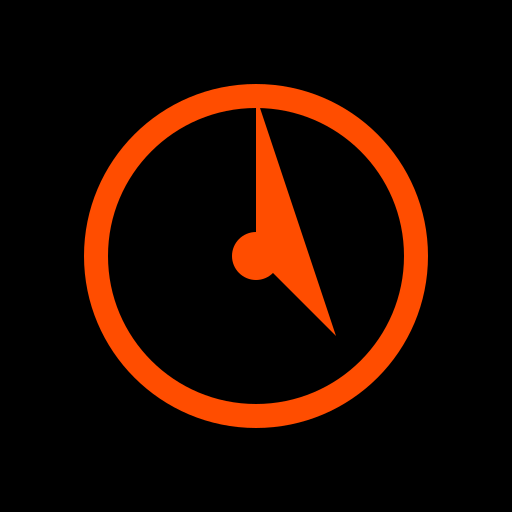

# Tempo

A brutalist Pomodoro timer for deep work. Sharp edges, hard shadows, mechanical precision. Focus. Break. Repeat.

<p align="center">
  
  <br>
  
  
  
  <br>
  <a href="https://github.com/Siikerloyd/Tempo/releases/latest">
    
  </a>
</p>

**Tempo** is a compact desktop timer that enforces the Pomodoro technique through a neo-brutalist interface designed to stay out of your way until you need it. No soft edges, no distractions—just a ticking clock and the discipline to sit with it.

## Download

Get the latest release from [GitHub Releases](https://github.com/Siikerloyd/Tempo/releases/latest).

- **Windows**: `Tempo-1.0.0-setup.exe`
- **macOS**: `Tempo-1.0.0.dmg`
- **Linux**: `Tempo-1.0.0.AppImage` or `tempo_1.0.0_amd64.deb`

---

## The Workflow

Tempo implements the classic Pomodoro technique with automatic mode switching:

```
FOCUS (25m) → BREAK (5m) → FOCUS (25m) → BREAK (5m) → FOCUS (25m) → BREAK (5m) → FOCUS (25m) → LONG (15m) → repeat
```

- **Focus**: Your deep work session. Orange ring, orange glow, attitude: "IN THE ZONE"
- **Break**: Short rest. Teal ring, attitude: "RECHARGE"
- **Long**: Extended rest after 4 focus sessions. White ring, attitude: "DEEP REST"

The 4-dot session cycle tracks your progress. Complete all 4 → earn a long break.

---

## Features

**Timer Engine**
- Circular progress ring with 60-120 tick marks that drain as time passes
- Rolling digit animations on every second change
- Final-minute heartbeat pulse when time is running low
- Progress bar at the bottom shows remaining percentage
- Energy glow intensifies as the session progresses

**Pomodoro System**
- Three modes: Focus (25m), Break (5m), Long (15m)
- Automatic mode switching on completion
- Session dots track the 4-cycle Pomodoro pattern
- Daily streak counter with flame icon (persists across launches)
- Mode-based color palette shifts (orange → teal → white)

**Visual Personality**
- Rotating microcopy by state: "LOCKED IN." "BREATHE." "FINISH STRONG." "DONE. NICE."
- Glitch effects on start, pause, and finish (chromatic aberration bursts)
- Play/pause icon morph (triangle ↔ bars) with smooth transition
- Subtle grid texture overlay on black background
- Sound wave animation when alarm is active

**Controls**
- Presets: 5m, 15m, 25m, 45m, 1h (instant start)
- Custom duration: hours / minutes / seconds input
- Always-on-top pin, minimize, close in custom title bar
- Brutalist button hover states (offset shadow lift)
- Press-into-shadow active feedback
- Custom alarm sound picker (saved to disk)
- Mute toggle with confirmation chirp
- Synthesized alarm fallback if MP3 fails

**Technical**
- Single-instance app (second launch focuses existing window)
- Audio throttling when timer is paused
- `prefers-reduced-motion` support (disables glitch, pulse, roll)
- localStorage for streak and alarm sound persistence
- Custom 512x512 desktop icon matching the timer design

---

## Design Philosophy

**Neo-Brutalist Aesthetic**

Every element follows three rules: hard edges, hard shadows, hard contrast.

- **Borders**: 2px solid black, never rounded
- **Shadows**: 4px offset white, no blur
- **Transitions**: `steps(2, end)`—mechanical, not smooth
- **Typography**: Monospace tabular numbers, uppercase labels, wide tracking
- **Colors**: Black (`#000`), White (`#FFF`), Orange (`#FF4F00`), plus mode accents

**Mode Palette**

| Mode | Accent | Dim | Track | Attitude |
| --- | --- | --- | --- | --- |
| Focus | `#FF4F00` | `#7A2600` | `#2A1A12` | "IN THE ZONE" |
| Break | `#00E5C7` | `#00574C` | `#0B2A26` | "RECHARGE" |
| Long | `#FFFFFF` | `#666666` | `#222222` | "DEEP REST" |
| Paused | — | `#6B4A3A` | — | "PAUSED" |

**Typography**

- Timer: Monospace, tabular nums, `1.7rem`, tracking-tight
- Labels: Monospace, `10px`, uppercase, tracking-widest
- Buttons: Monospace, `9px`, uppercase, font-bold

**States**

| State | Ring | Color | Microcopy |
| --- | --- | --- | --- |
| Idle | Full | White | "READY WHEN YOU ARE." |
| Paused | Dimmed | White | "PAUSED" / "HOLDING." |
| Running | Draining | Orange/Teal/White | "IN THE ZONE" / "RECHARGE" |
| Urgent (≤60s) | Pulsing | Accent | "ALMOST." |
| Alarm | Empty | Orange | "DONE. NICE." |
| Edit | Hidden | — | — |

---

## Tech Stack

<p align="center">
  
  
  
  
  
</p>

- **Electron**: Desktop wrapper, IPC, native dialogs
- **React**: Component state, hooks, rendering
- **Tailwind CSS**: Utility classes (extended with custom tokens)
- **Sharp**: Icon generation from SVG
- **Lucide React**: Icon set (BellRing, Flame, Play, Pause, etc.)

---

## Run Locally

<p align="center">
  
  
</p>

```bash
cd Tempo
npm install
npm run dev    # Development with hot reload
npm start      # Production preview
```

---

## Package as Desktop App

Close any running dev window first.

```bash
# Windows installer
npm run build:win

# macOS
npm run build:mac

# Linux
npm run build:linux
```

Installers land in `dist/`. On Windows: `Tempo-1.0.0-setup.exe`.

Unpacked folder (no installer):

```bash
npm run build:unpack
```

---

## Project Structure

```text
src/
├── main/           Electron window, IPC, alarm file picker
├── preload/        Bridge to renderer
└── renderer/
    ├── src/
    │   ├── components/
    │   │   ├── Timer.jsx       # Main timer with modes, streak, effects
    │   │   ├── TopBar.jsx      # Title bar with pin/minimize/close
    │   │   └── inputField.jsx  # Time input component
    │   ├── assets/
    │   │   ├── logo.svg        # In-app timer logo
    │   │   ├── main.css        # Brutalist CSS tokens & animations
    │   │   └── audio/Alarm.mp3 # Default alarm sound
    │   ├── App.jsx             # Root component
    │   └── main.jsx            # Entry point
    └── index.html

build/              App icon (.png)
resources/          Window icon (.png)
```

---

## Acknowledgments

Built with using:
- Electron for desktop packaging
- React for component logic
- Tailwind CSS for utility styling
- Lucide for iconography

Design inspiration from the Pomodoro Technique and neo-brutalist UI movements.
